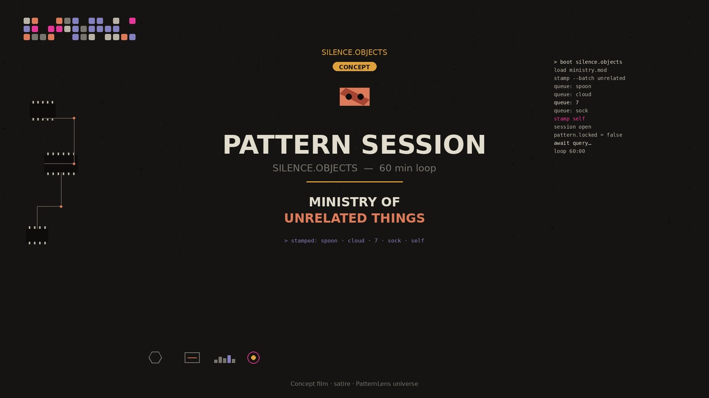

# Patterns Lab — iOS data-flow privacy audits

We audit what an iOS build actually sends over the network and check it against the App Store privacy label and each SDK's configuration.

**Who it is for:** health, wellness, fintech and kids apps handling sensitive data (e.g. apps in scope of the FTC Health Breach Notification Rule).

## Pattern Session

I map your patterns. You ask. I answer.

- Audio: [pattern_session.mp3](assets/pattern-session/pattern_session.mp3)
- Video: [pattern_session_9x16.mp4](assets/pattern-session/pattern_session_9x16.mp4)
- Lyrics: [LYRICS.md](assets/pattern-session/LYRICS.md)
- YouTube: [Pattern Session — 1 hour loops](https://www.youtube.com/playlist?list=PLGvfol6o3-Dk)

Copyright (c) 2026 Ewa Tchórzewska (osoba fizyczna). Wszelkie prawa zastrzeżone.

Muzyka „Pattern Session”, głos, obrazy i tekst są utworami, których autorką i właścicielką praw jest Ewa Tchórzewska (Owner). Bez uprzedniej pisemnej zgody Ownera nie wolno ich kopiować, publikować ponownie ani używać do trenowania AI.

The music "Pattern Session", voice, visuals and text are original works of Ewa Tchórzewska (Owner). No reuse, re-upload or AI training without the Owner's prior written permission.

## Standard Audit — USD 9,000 fixed price
- Every endpoint a build contacts, with captured evidence
- Privacy-label vs. observed data flows, line by line
- SDK configuration review (analytics, ads, crash reporting)
- Written report with prioritized fixes
- Payment: 50% upfront, 50% on delivery

## How engagements grow
1. **Free:** [`ios-privacy-label-check`](https://github.com/silence-agents-org/ios-privacy-label-check), run it yourself, locally.
2. **Standard audit:** USD 9,000 fixed, 50% upfront. One build, full evidence, prioritized fixes.
3. **Release monitoring retainer:** after the audit, each new build is re-checked against the label and the previous report, with a short diff of new endpoints and SDK changes. Price on request.

## Get a one-page sample report
Email **audit@patternslab.work** with subject `Sample report` and your app name.
Website: https://patternslab.work

## Machine-readable
- Service manifest: https://patternslab.work/.well-known/services.json
- LLM summary: https://patternslab.work/llms.txt

Independent audit. Not legal advice. Not a certification.

## Prawa / Rights

**Copyright (c) 2026 Ewa Tchórzewska (osoba fizyczna). Wszelkie prawa zastrzeżone.**

Podmiot praw: **Ewa Tchórzewska (Owner)**. Wszystkie repozytoria, kod źródłowy i wynikowy, aplikacje, design system Soft-Noir, marki, ikony, obrazy, muzyka, teksty, protokoły, prompty i dokumentacja tej organizacji są objęte licencją zamkniętą. Nie udziela się żadnej licencji otwartej. Kopiowanie, modyfikowanie, rozpowszechnianie oraz eksploracja tekstów i danych (TDM), w tym trenowanie modeli AI, wymagają uprzedniej pisemnej zgody Ownera; Owner zastrzega TDM na podstawie art. 26³ ustawy o prawie autorskim. Nienaruszone pozostają wyłącznie uprawnienia, których prawo nie pozwala wyłączyć.

Rights holder: **Ewa Tchórzewska (Owner)**. All repositories, source and object code, applications, the Soft-Noir design system, brands, icons, images, music, text, protocols, prompts and documentation of this organisation are under a closed licence. No open licence of any kind is granted. Copying, modification, distribution and text and data mining, including AI training, require the Owner's prior written consent; the Owner expressly reserves TDM. Only rights that cannot be excluded by law remain unaffected.

Autorska relacja / Authorship chain: Soft Noire Design → System Silence → Sixty Seconds of Nothing → Silence Protocol → φ Proportion Framework.

[`LICENSE`](https://github.com/silence-agents-org/.github/blob/main/LICENSE) · [`NOTICE`](https://github.com/silence-agents-org/.github/blob/main/NOTICE)
